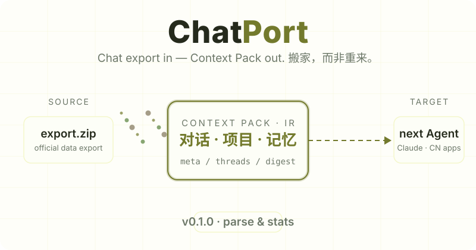
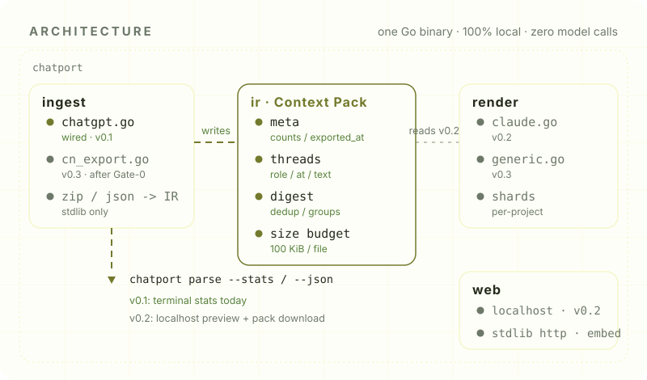
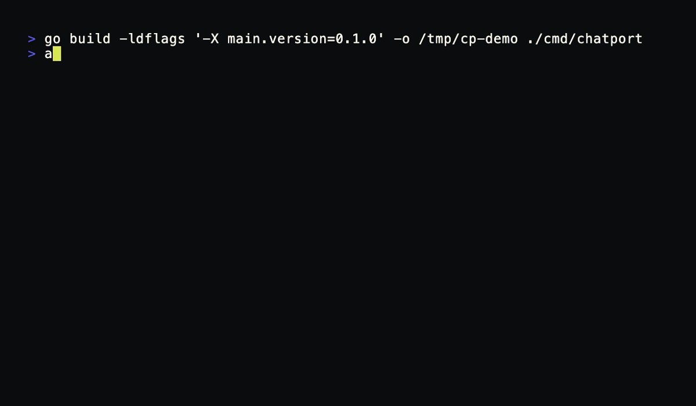

[English](./README.en.md) | **简体中文**

<div align="center">

<picture>
  <source media="(prefers-color-scheme: dark)" srcset="assets/hero-dark.svg" />
  <source media="(prefers-color-scheme: light)" srcset="assets/hero-light.svg" />
  
</picture>

**把 AI 助手的官方对话导出，变成下一个 Agent 一口吃下的上下文包。**

你在 ChatGPT 里聊了三年的项目和决策，不该在换到 Claude、Kimi 或一个新的 Coding Agent 时从零再来。ChatPort 把官方导出的对话记录变成下一个 Agent 一口能吃下的上下文包 —— 搬家，而非重来。

[](./LICENSE)
[](https://go.dev)
[](https://github.com/SuperMarioYL/chatport/releases)
[](#为什么搬家这么难)

[为什么](#为什么搬家这么难) · [工作方式](#工作方式) · [快速开始](#快速开始) · [命令](#命令) · [演示](#演示) · [定价](#定价) · [路线图](#路线图) · [开发](#开发)

</div>

> **当前版本（v0.1.0）实现范围**：ChatGPT 官方导出 zip 的解析、Context Pack 中间表示、终端统计，以及本地占位预览页。拖拽预览与上下文包下载在 v0.2，国产 App 适配在 v0.3 —— 见[路线图](#路线图)。本文只宣传已经实现的能力。

## 为什么搬家这么难

多助手重度用户的真实工作流是：在 ChatGPT 里磨一个项目，拿去 Claude 写方案，再开一个 Coding Agent 把它做出来。每次切换都要复制背景、重新解释决策，因为：

- **官方导出是给监管看的数据所有权文件，不是给下一个助手吃的格式。** 一份 ChatGPT 导出动辄几百 MB，混着系统字段，任何项目知识库的上传入口都消化不了。
- **没有任何助手提供"吃进别人历史"的入口。** 导出功能厂商愿意做（满足数据可携带），导入功能厂商没动力做（等于承认 switching cost）——这条缝就一直空着。
- **复制粘贴是最差的通道。** 记忆、项目结构、之前的决策全部丢在搬家路上，积累越多的用户损失越大。

ChatPort 做的是缺失的另一半：**ingest**。读入官方导出的完整 zip，归一化为统一的 Context Pack，输出统计，再（v0.2 起）渲染成目标 App 的上传入口真正吃得下的 Markdown 上下文包。全程本地、单二进制、零模型调用。

## 工作方式

一个 Go 二进制，三条内部管线，无数据库、无服务端依赖、不联网：

<picture>
  <source media="(prefers-color-scheme: dark)" srcset="assets/architecture-dark.svg" />
  <source media="(prefers-color-scheme: light)" srcset="assets/architecture-light.svg" />
  
</picture>

| 模块 | 职责 | 状态 |
| --- | --- | --- |
| `internal/ingest` | zip/json 解析，归一化进 Context Pack；`chatgpt.go` 已接入，`cn_export.go` 为国产适配预留 | 解析已实现 |
| `internal/ir` | Context Pack 类型：meta / threads / digest（去重指纹、项目分组、单文件大小预算） | 已实现 |
| `internal/render` | 目标 App 渲染器：Claude Projects 分片包（v0.2）、通用知识库包（v0.3） | 契约已定，实现见路线图 |
| `internal/web` | localhost 预览页（embed 静态资源，stdlib http） | v0.1 为占位页 |

所有导出解析器写进同一个 IR，所有渲染器从同一个 IR 读出——国产适配器只是多一个 ingest 实现，不新增进程。

## 快速开始

需要 Go 1.24+，从源码安装（也可以 `go install`）：

```bash
git clone https://github.com/SuperMarioYL/chatport
cd chatport
make build          # 产出单文件二进制 ./chatport
```

**第一次运行**——仓库自带一份合成样例导出（仅演示格式，非真实数据）：

```bash
./chatport parse examples/sample-chatgpt-export.zip --stats
```

**搬你自己的历史**：

1. ChatGPT → 设置 → 数据控制 → 导出数据；确认后等导出邮件（这是唯一的等待步骤，发生在流程之外，不占操作时间）。
2. 从邮件下载导出 zip。
3. 运行：

```bash
./chatport parse 你的导出.zip --stats
```

每一步的用户操作都控制在一分钟内。v0.2 起，`chatport open` 的本地页面会接管"拖入 → 勾选 → 下载上下文包"的完整流程。

## 命令

| 命令 | 作用 |
| --- | --- |
| `chatport parse <export.zip>` | 解析导出 zip，输出概要统计（来源、对话数、消息数、时间跨度、项目分组） |
| `chatport parse <export.zip> --stats` | 附每对话明细：消息数、重复条数、所属项目、时间范围 |
| `chatport parse <export.zip> --json` | 输出完整 Context Pack IR（JSON） |
| `chatport open` | 启动 localhost 预览页并自动打开浏览器（v0.1 为占位页，交互预览在 v0.2） |
| `chatport --version` | 版本号 |

`--json` 暴露的就是 v0.2 渲染器消费的中间表示：

```json
{
  "meta":   { "source_app": "chatgpt", "n_conversations": 4, "n_messages": 19 },
  "threads": [ { "id": "…", "title": "【项目】博客重构", "project_hint": "项目", "messages": [ … ] } ],
  "digest": { "dedup_index": {…}, "dup_messages": 1, "size_budget_per_file": 102400, "per_project_groups": {…} }
}
```

设计取舍写在明面上：**v0.1 的转换是确定性规则、零模型调用**。去重只认"空白归一后逐字相同"的消息（sha256 指纹），项目分组只认标题前缀（`【…】`、`[…]`、`Project:`、`项目：`）——可解释、可复现，也意味着不聪明；规则会随 v0.2 的渲染需求演进。ChatGPT 导出本身不含 memory 与自定义指令，包里也就没有；被编辑掉的回复分支（非 current_node 路径）不保留。

## 演示

<p align="center">
  
</p>

上面是真实终端录屏（录制脚本 [`assets/demo.tape`](assets/demo.tape)，可 `make demo` 复现）。完整复现记录——输入、命令、原始输出、版本与限制——在 [`docs/demo-results.json`](docs/demo-results.json)。录屏使用的样例 zip 是合成的（[`examples/`](examples/README.md)），你自己的导出 zip 输出同样的统计。

拖入 zip → 勾选对话 → 下载 `claude-projects-pack.zip` 的图形演示，随 v0.2 一起录制。

## 生态位

按分工看这条工具链的位置，而不是比谁的功能多：

| 阶段 | 谁负责 | 产出 |
| --- | --- | --- |
| 导出 | 各助手的官方导出（或浏览器导出插件） | 原始归档：面向"带走"，格式按数据所有权设计 |
| 转换 | **ChatPort（本项目）** | Context Pack：去重、按项目分组、按预算分片——面向"被吃下" |
| 上传 | 目标 App 已有的项目知识 / 文件上传入口 | 上下文生效 |

转换这一环目前没有人认真做：这是和持续变化的私有导出格式赛跑的体力活，v0.1 只接 ChatGPT 一对，国产适配按 Gate-0 审计结果逐对解锁（见[路线图](#路线图)）。

## 定价

不订阅、不要账号、不上传数据——一次性买断，和搬家的场景一致：

| | 免费档 | 买断 ¥68（早鸟 ¥39 / 国际 $19） |
| --- | --- | --- |
| 转换对 | ChatGPT → Claude（单对） | 全部已接入的来源与目标 |
| 历史范围 | 最近 30 天对话 | 全量历史 |
| 上下文包 | 单对话包 | 项目级分组包 + 全量包 |
| 激活方式 | — | `chatport activate <买断码>`，ed25519 离线验签，本机完成、无网络请求 |

购买渠道：国内爱发电 / 面包多自动发码，国际 Stripe Payment Link。渠道链接与离线校验随 v0.2 / v0.3 的发布节奏开通（见[路线图](#路线图)），本节第一时间更新。当前 v0.1 处于内测期，解析与统计功能免费使用；欢迎在 Issues 里反馈搬家前后的真实体验。

## 路线图

| 版本 | 内容 | 状态 |
| --- | --- | --- |
| v0.1（m1） | ChatGPT 导出解析、Context Pack IR、终端统计、本地占位预览页 | **已完成** |
| v0.2（m2） | 本地预览页：拖入 zip → 解析进度 → 勾选对话 → 一键下载按项目分组、去重、按大小预算分片的 Claude Projects 友好 Markdown 包 | 开发中 |
| v0.3（m3） | Gate-0 审计通过的一对国产 App 适配、通用知识库渲染、macOS / Windows / Linux 三平台二进制、买断码离线校验 | 规划中 |

两点前提，写在这里是为了可被检验：国产适配以 Gate-0 审计为前提——对应 App 必须存在可解析的结构化导出，且目标 App 有官方上传 / 项目知识入口，否则该对不解锁；如果任何一家助手厂商上线了官方导入，这个工具的使命即完成，项目停止更新。

## 开发

```bash
make build     # 构建（版本号取自 VERSION）
make test      # go test ./...
make vet       # go vet ./...
make example   # 从 examples/sample-export 重建样例 zip
make demo      # 用 vhs 重录 assets/demo.gif
```

```
cmd/chatport/       CLI 入口（cobra）
internal/ingest/    导出解析：chatgpt.go（已接入）、cn_export.go（v0.3 预留）
internal/ir/        Context Pack：类型、去重指纹、项目分组、统计
internal/render/    目标渲染器契约：claude.go（v0.2）、generic.go（v0.3）
internal/web/       本地预览：embed 静态页 + stdlib http
```

第三方依赖仅 cobra；zip、HTTP、静态资源全部走标准库。golden 样本测试覆盖解析器的关键行为：编辑分支取 current_node、隐藏系统消息跳过、代码块内容保留、跨对话去重计数。

<p align="center"><sub><a href="./LICENSE">MIT</a> © 2026 SuperMarioYL</sub></p>
